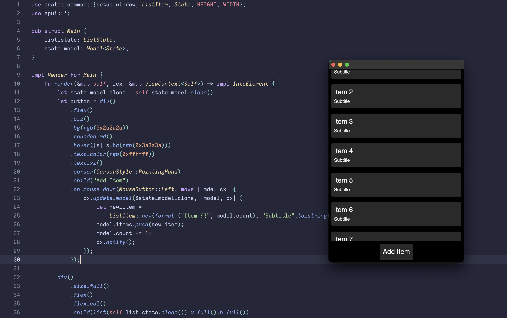

# GPUI List Examples

Example implementations of lists using [GPUI](https://github.com/zed-industries/zed/tree/main/crates/gpui).

## Running Examples

```sh
# Run the simple list example (default)
cargo run

# Or explicitly:
cargo run --bin simple

# Run the global list example
cargo run --bin global
```

## Examples

### Simple List

The [simple_list](./src/simple_list.rs) example has the model and list in one view. It demonstrates basic list state management with event emission to update the list when items are added.

### Global List

The [global_list](./src/global_list.rs) example leverages a model in the global context. This demonstrates how sibling components can independently read from and react to shared state.

```
┌─────────────────────────────────┐
│           Workspace             │
├─────────────────────────────────┤
│  Header   │   List   │  Input   │  ← sibling components
│     ↓           ↓          ↓    │
│         GlobalStateModel        │  ← all subscribe independently
└─────────────────────────────────┘
```

**Components:**

- **Header** - Subscribes to state changes and displays the total item count
- **List** - Subscribes to state changes and rebuilds the list when items are added
- **Input** - Triggers state updates via `StateModel::update()` / `push()`

All three components subscribe to `AddListItemEvent` independently, demonstrating a scalable architecture pattern where components react to global state changes without direct coupling to each other.

## Common Components

The common `ListItem` component and shared utilities are in [common.rs](./src/common.rs).

## Screenshot


